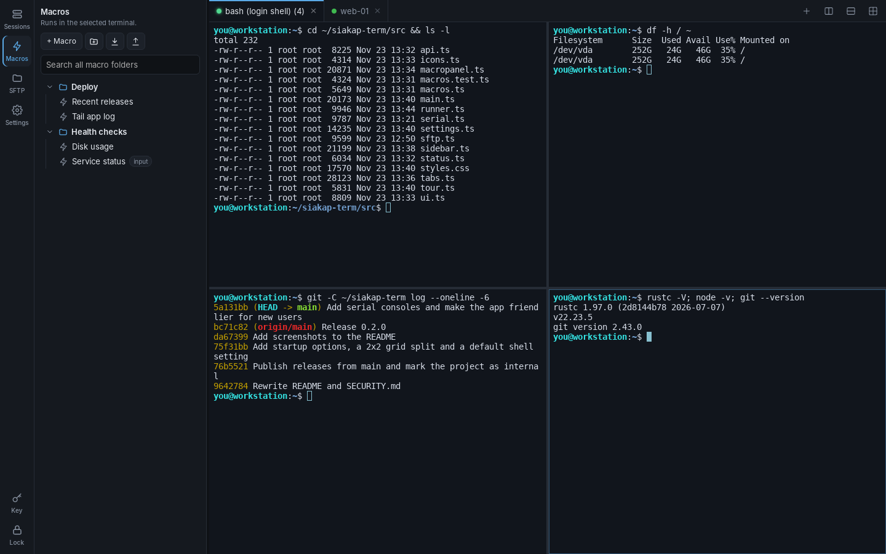
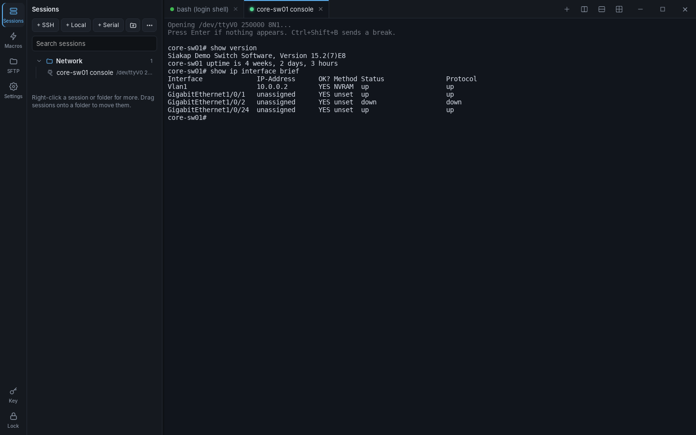

# Siakap Terminal

Siakap Terminal is an internal terminal and SSH client for Windows 10 and 11. I wanted something that looks as clean as Tabby,
has MobaXterm's habit of putting an SFTP browser next to the terminal, and keeps the macros I've been using in
Siakap. It also had to keep everything encrypted on disk and stay quiet on the network.

It runs on Linux too. macOS will probably work, but I haven't tried it.

**[⬇ Download the latest version](https://github.com/Shaqqiem/siakap-term/releases/latest)** · [How to install](#installing)


<table>
  <tr>
    <td width="50%"></td>
    <td width="50%"></td>
  </tr>
  <tr>
    <td align="center"><sub>Four panes in one tab</sub></td>
    <td align="center"><sub>A macro asking for a value, with a live preview</sub></td>
  </tr>
  <tr>
    <td width="50%"></td>
    <td width="50%"></td>
  </tr>
  <tr>
    <td align="center"><sub>Serial console over a USB cable</sub></td>
    <td align="center"><sub>SFTP over the same connection</sub></td>
  </tr>
</table>

## Features

- **Tabs and split panes.** Local shells (PowerShell 7, Windows PowerShell, cmd, and any WSL distro) and SSH
  sessions, in tabs that split side by side, top and bottom, or straight into a 2×2 grid. You can drag the dividers.
- **Starts where you left off.** Pick what opens when the app starts: nothing, a shell such as your WSL distro, or a
  saved session, in one, two or four panes. You can also choose which shell new tabs use.
- **Encrypted vault.** Sessions, folders, macros, known hosts, settings and saved passwords all live in one file,
  encrypted with Argon2id and XChaCha20-Poly1305. It locks itself after a configurable idle time, or when you click
  Lock.
- **SSH.** Authentication tries the Windows OpenSSH agent first, then Pageant, then a key file (with a passphrase
  prompt) or a password. FIDO security keys work through the agent. Host keys are trusted on first use, and a
  changed key is refused, full stop.
- **Macros (Siakap compatible).** A macro types a list of commands into the terminal you clicked last. Highlight a
  value and click *Make input* to be asked for it on every run (`{{Switch port}}`), with a live preview and a paste
  button. Optionally edit the whole command before a run without changing the saved macro. Organise them in folders
  with drag and drop, duplicate, rename, search across folders (and inside commands), and import or export Siakap
  backups, including the ones made by the Siakap Tabby plugin.
- **Startup commands.** A saved session can type commands once its prompt is ready, optionally in a start folder.
- **Command status on tabs.** The dot on each tab turns blue while a command runs, green on success and red on
  failure.
- **Serial consoles.** Connect to switches, routers and other devices over a COM port, like you would in PuTTY or
  MobaXterm. Ports are detected automatically (plug in a USB console cable and it shows up), the speed is picked
  from a dropdown (9600 by default, up to 921600, or a custom rate), and data bits, parity, stop bits and flow
  control can be changed. `Ctrl+Shift+B` sends a break for password recovery.
- **SFTP.** The side panel follows whichever SSH tab is focused and reuses its connection. Browse, create folders,
  rename, delete, download and upload with the native file dialogs, or drag files onto the panel. Transfers stream in
  chunks, show progress and can be cancelled. An interrupted upload never damages the file already on the server, and
  Siakap asks before replacing an existing file.
- **Security keys in WSL.** The Key button lists your connected security keys, and lets you attach one to WSL or
  detach it back to Windows with `usbipd`. Siakap checks afterwards that the key really moved.
- **Themes that reskin everything.** A theme colours the terminals, the whole app (light themes give a light app) and
  the app icon.
- **Sound and fun.** A chime when long commands finish, soft interface sounds, a pixel-siakap screensaver and a
  welcome splash, all optional.
- **Themes.** A gallery of colour themes (Campbell, One Half Dark, Dracula, Nord, Gruvbox, Tokyo Night, Solarized
  and more), a full colour editor, your own saved themes, and import/export as JSON, including Windows Terminal
  colour schemes.
- **No phoning home.** There is no telemetry, no automatic update check and no analytics, and the app loads no remote
  fonts or scripts. The only network connections it makes are the SSH sessions you open, and a request to GitHub when
  you click **Check for updates** in Settings → About.

## Installing

**[Download the latest version from the Releases page](https://github.com/Shaqqiem/siakap-term/releases/latest)**
(you need access to this repository).

1. On the Releases page, scroll down to **Assets** under the newest version.
2. Download **`Siakap.Terminal_<version>_x64-setup.exe`**, for example `Siakap.Terminal_0.5.2_x64-setup.exe`.
   It installs for your Windows user only, so you don't need admin rights. The `.msi` file is the same app for
   IT-managed installs; you only need one of the two.
3. Run the file you downloaded. If Windows shows *"Windows protected your PC"*, click **More info**, then
   **Run anyway**. The installer isn't code-signed yet, which is why Windows asks.
4. Open **Siakap Terminal** from the Start menu.

**Updating:** click **Check for updates** in Settings → About, then **Download and install**: Siakap downloads the
new version, checks it against the release's checksum, and after a 3-second countdown closes, updates itself and opens
again. (Or download the newer `setup.exe` from the Releases page and run it.) It installs over the old version without uninstalling it first, and your sessions, macros and
settings are kept. After an update, Siakap shows a short tour of what's new.

> Installers up to 0.6.2 asked "Uninstall before installing?" when updating. If you see that, choose **Do not
> uninstall**, or if you do uninstall, leave **Delete the application data** unticked: that box deletes your vault.

You need Windows 10 or 11 (x64). The app uses WebView2, which Windows 11 already has; on Windows 10 the installer
adds it if it's missing. If you want agent authentication, turn on the OpenSSH agent service or run Pageant. The
security key button needs [usbipd-win](https://github.com/dorssel/usbipd-win) 4.x.

<details>
<summary>Checking the download (optional)</summary>

Each release also has a `SHA256SUMS.txt` with a fingerprint for each installer. To check that your download is
exactly what GitHub built, run this in PowerShell in your Downloads folder and compare the result with the matching
line in `SHA256SUMS.txt` (capital letters don't matter):

```powershell
Get-FileHash -Algorithm SHA256 .\Siakap.Terminal_0.5.2_x64-setup.exe
```

</details>

The first time it starts, Siakap asks you to choose a master password and creates the vault at
`%APPDATA%\dev.siakap.terminal\vault.json`. Use at least 12 characters (a short sentence works well). There's no recovery if you forget the password.

If you'd rather not type it every time, untick **Settings → Security → Ask for the master password when Siakap
opens** (it asks for the password once to confirm). Siakap then opens straight away on this PC, for your Windows
account only. The Lock button and auto-lock still ask for the password. Tick the box again to go back.

On Windows you can also skip the master password entirely: on the first-launch screen, tick **Don't use a master
password on this PC**. The vault is still encrypted, but only your Windows account on this PC can open it, and Lock
just hides the window behind an **Open** button. If your Windows account is reset or you move to a new PC, that vault
can't be opened, so export a backup now and then. You can add a password later with **Settings → Security → Set a
master password**.

## Using it

| What | How |
| --- | --- |
| New tab | `Ctrl+Shift+T` or the + button always open a new tab (with what *Settings → New tabs open* says). Right-click + for any terminal or saved session |
| Split a tab | `Ctrl+Shift+D` side by side, `Ctrl+Shift+E` top and bottom, `Ctrl+Shift+G` four panes. Each new pane starts empty and asks what to show: move one of your open sessions into it, open a terminal, or pick a saved session. Double-clicking a session in the Sessions panel also fills the empty pane. A tab is split once; close a pane to change it (up to 4 panes) |
| Open a serial console | **+ Serial** in the Sessions panel, or right-click + |
| Send a break (serial) | `Ctrl+Shift+B` |
| Close a pane | The x in the pane's corner, right-click → *Close this pane*, `Ctrl+Shift+W`, or Enter once the session has ended |
| Move a tab | Drag it left or right. Right-click a tab to rename, duplicate or close tabs |
| Switch tabs | `Ctrl+Tab` and `Ctrl+Shift+Tab` |
| Copy and paste | Right-click pastes; with text selected, right-click copies it. Shift+right-click for the menu. Also `Ctrl+Shift+C` and `Ctrl+Shift+V`. Both are in *Settings → Mouse and clipboard* |
| Organise sessions | The folder button makes a folder; drag sessions onto it. Right-click a session or folder for more. Click a folder to collapse it |
| Save what's on screen | Right-click a tab, or Shift+right-click in the terminal → *Save output to file...* (scrollback included, as plain text) |
| Log a session | Same menus → *Log to file...*; a red REC badge shows while it records. *Settings → Session logs* can log every terminal automatically into a folder you choose |
| Settings | The gear in the left rail opens Settings as its own tab: Appearance, Terminal, Startup/tabs/window, Connections, Mouse and clipboard, Macros, Files and logs, Security, Trusted servers, Keyboard shortcuts and About, with a search box. Changes save as you make them. The version is shown at the top |
| Change the look | *Settings → Appearance*: pick a theme from the gallery, customise every colour (including the 16 terminal colours and the app's accent), save your own themes, and import or export them. Windows Terminal colour schemes can be imported directly |
| Sounds and effects | *Settings → Sound and effects*: a chime when a tab finishes a long command (adjustable threshold), soft interface sounds, volume, the pixel-siakap screensaver and the welcome splash |
| Undo a setting | **Undo** (or `Ctrl+Z`) and **Revert all** at the bottom left of Settings |
| Change the font | *Settings → Terminal → Font* lists the fonts installed on your PC, fixed-width ones first. Line spacing, cursor shape and blinking, history length and the terminal bell are there too |
| Stop a running macro | `Esc`, or the Stop button in the macro bar |
| Hide the side panel | Click the active icon in the left rail, or double-click the panel edge |

When the clipboard contains more than one line, the app shows what's about to be pasted and asks first. You can turn
this off in Settings, but I'd leave it on.

### Writing macros

```text
# Lines starting with # are notes.
show interface {{Switch port}} status
# @wait 1500
# @type y
```

Each ordinary line is typed and followed by Enter; blank lines are skipped. The `#` before `@wait` and `@type` is
optional, and `@ wait 100` or `@WAIT 100` work too; other lines starting with `@` (such as `@echo off`) are typed as
normal. The editor shows what each line will do as you write it. `# @wait 1500` pauses for 1.5 seconds
(the limit is one hour, and Stop cancels the wait). `# @type y` types `y` without pressing Enter. `@key tab` presses a key: enter, tab, up, down, left, right, esc, backspace, home, end, pageup,
pagedown, delete, or ctrl+c/d/z/l/a/e/u/r. `{{Switch port}}` is
an input: it's asked for once per run, however many times it appears, and its name can contain spaces. The easiest
way to make one is to highlight the value in the editor, type a name and click **Make input**.

By default, placeholder values may only contain letters, digits, spaces and `_ . / : @ , + -`, which keeps a stray
`;` or `$(...)` out of your commands. You can switch to unrestricted mode in Settings; control characters are still
rejected there, so a value can never sneak in an extra Enter.

A macro only types into the pane that had focus when you started it. If that pane closes or you click into another
one, the macro stops.

### Moving from the Siakap Tabby plugin

In the Siakap plugin, export a backup (*Export sessions and macros*). In Siakap Terminal, open **Macros** and click
the import button, then pick that file. Macros, folders and SSH, local and serial sessions come across, along with their
startup commands. Two things are deliberate:

- Imported macros ask you to review them before their first run.
- Imported startup commands are switched off until you turn them on in each session.

Passwords are never part of a backup.

### Moving from MobaXterm

In MobaXterm, right-click **User sessions** > **Export all sessions to file** (`.mxtsessions`), and export your macros
(`.mxtmacros`). You can also use your `MobaXterm.ini`. In Siakap Terminal, click the import button in the **Macros**
panel and pick both files at once.

- **Sessions:** SSH, SFTP (as SSH), serial and WSL sessions come across in the same folders. Other session types
  (RDP, VNC, Telnet, FTP, ...) are listed as skipped.
- **Macros:** recorded steps are turned into Siakap macros: typed text, Enter, Tab and arrow keys (`@key`), and pauses
  (`@wait`).
- **Login macros:** a session's login macro, whether its own steps or a named macro, and its "execute command" become
  startup commands. They are imported switched off; check one, then turn them all on from the import summary.
- **Passwords:** passwords saved in MobaXterm are not imported.

### Guided tour

The first time you start Siakap Terminal, a short tour points out each part of the app. After an update, it only
shows what's new since the version you last used. Replay it any time from **Settings > About > Show the tour again**.

### Startup

Under Settings > Startup and tabs you can choose what opens when Siakap starts:

- **When Siakap starts:** nothing, a local shell, or one of your saved sessions.
- **Layout:** one pane, two side by side, or a 2×2 grid of that shell or session.
- **Default shell for new tabs:** for example `WSL: Ubuntu`, so `Ctrl+Shift+T` opens WSL instead of PowerShell.

The startup action runs once, the first time you unlock the vault after starting the app.

### Security keys and WSL

usbipd has to share the key once, and that needs an elevated terminal. Siakap won't try to elevate for you:

```powershell
usbipd list
usbipd bind --busid <BUSID>
```

After that, click **Key** in the left rail. It lists the security keys that are plugged in, with your usual key marked
and shown first, and their BUSID and state. Pick one, then choose **Attach to WSL** or **Detach**:

- If more than one key is connected, nothing is selected for you.
- Right before acting, Siakap reads the device list again. If the key was unplugged, moved to another port or swapped,
  it stops instead of acting on a different device.
- If the key is already where you asked, nothing is sent.
- Afterwards Siakap waits for Windows (at most 6 seconds) to re-detect the key, and confirms the new state by the key's
  sharing identity. A key that disappeared is never reported as a success.
- Anything unexpected in usbipd's output stops with an error rather than a guess.

## Building from source

On Windows you need [Rust](https://rustup.rs) (stable, MSVC toolchain), the "Desktop development with C++" workload
from the Visual Studio Build Tools, and [Node.js](https://nodejs.org) 22 or newer.

```powershell
npm ci
npm run tauri dev
```

`npm run tauri build` produces the installers in `target\release\bundle\nsis` and `target\release\bundle\msi`.

On Linux you'll also need the WebKitGTK and udev development packages:
`libwebkit2gtk-4.1-dev librsvg2-dev libayatana-appindicator3-dev libudev-dev`.

### Tests

```powershell
cargo test -p siakap-core
npm test
npm run build
```

The Rust tests cover the vault, the macro parser, folder handling, usbipd output parsing and host-key checks. `npm test`
runs the TypeScript macro parser tests with Node's built-in runner. `npm run build` type-checks the frontend and
builds it.

There's also a live SSH and SFTP test. It only runs when you point it at a real server whose home directory contains a
file called `big.bin`:

```powershell
$env:SIAKAP_TEST_SSH = "user:password@127.0.0.1:22"
cargo test -p siakap-core --test ssh_live
```

CI runs the tests on `windows-latest` and builds both installers on every push (see
[`.github/workflows/build.yml`](.github/workflows/build.yml)). The first time a new version number reaches `main`,
CI also publishes a release for it with the installers and `SHA256SUMS.txt`. To ship an update, bump `version` in
`src-tauri/tauri.conf.json` and `package.json`, then push to `main`.

## Project layout

```text
core/              Rust library with no Tauri dependency
  vault.rs           encrypted storage
  remember.rs        optional Windows-protected key (open without the master password)
  model.rs           sessions, macros, settings, folder rules
  macros.rs          macro parser and input validation
  backup.rs          import and export (Siakap backups)
  mobaxterm.rs       MobaXterm session and macro import
  fonts.rs           installed font list for the font picker
  process.rs         running programs with fixed arguments and time limits
  pty.rs             local shells (ConPTY on Windows)
  ssh.rs             SSH client and host-key checks
  sftp.rs            SFTP over an existing SSH connection
  serial.rs          serial ports and consoles
  security_key.rs    usbipd integration
src-tauri/         Tauri commands, app state and capabilities
src/               TypeScript frontend built on xterm.js
docs/screenshots/  images used in this README
```

## Known limitations

- SFTP can only delete empty folders.
- If an agent offers OpenSSH certificates, those are skipped; plain keys work.
- Locking the vault hides your terminals but doesn't disconnect them, unless you turn on *Disconnect all sessions
  when Siakap locks* in Settings. SECURITY.md explains why.
- Keyboard-interactive login (servers that prompt for a one-time code) isn't supported yet.

## Security

See [SECURITY.md](SECURITY.md) for what the app protects against, what it doesn't, and how to report a problem.

## License

Proprietary. For internal use only; not for redistribution.
