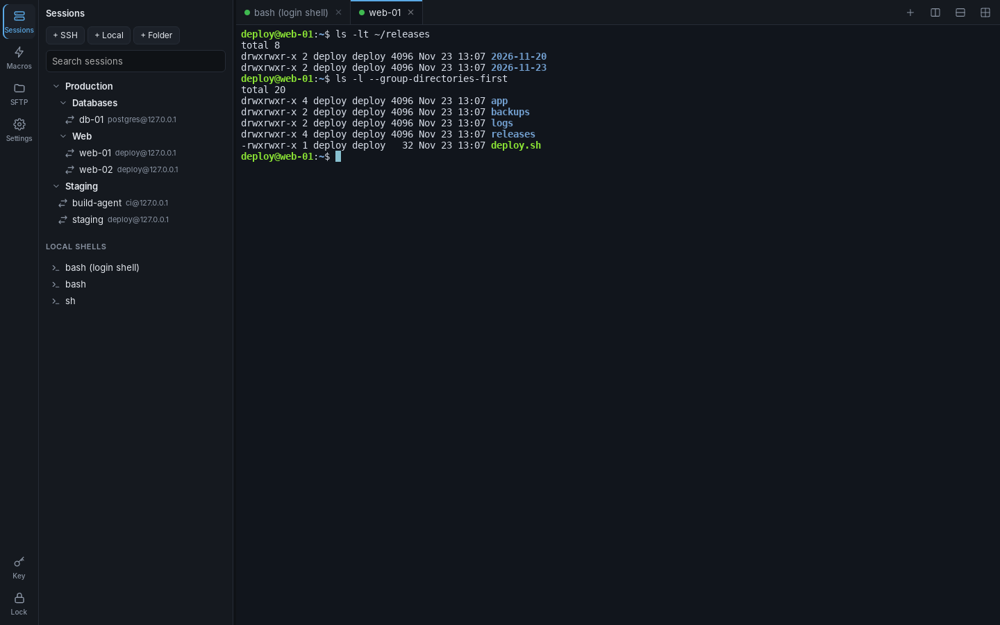
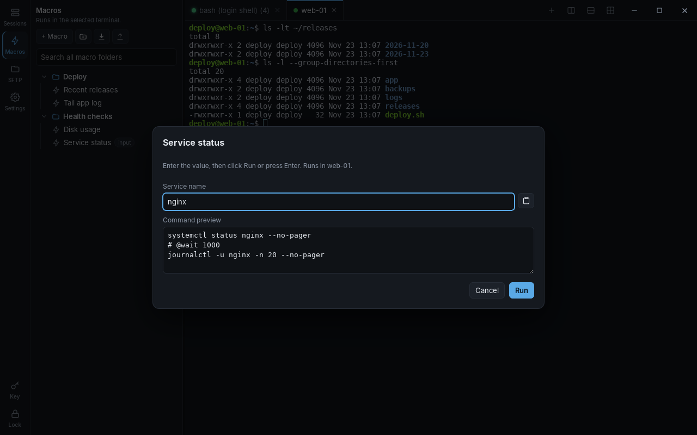
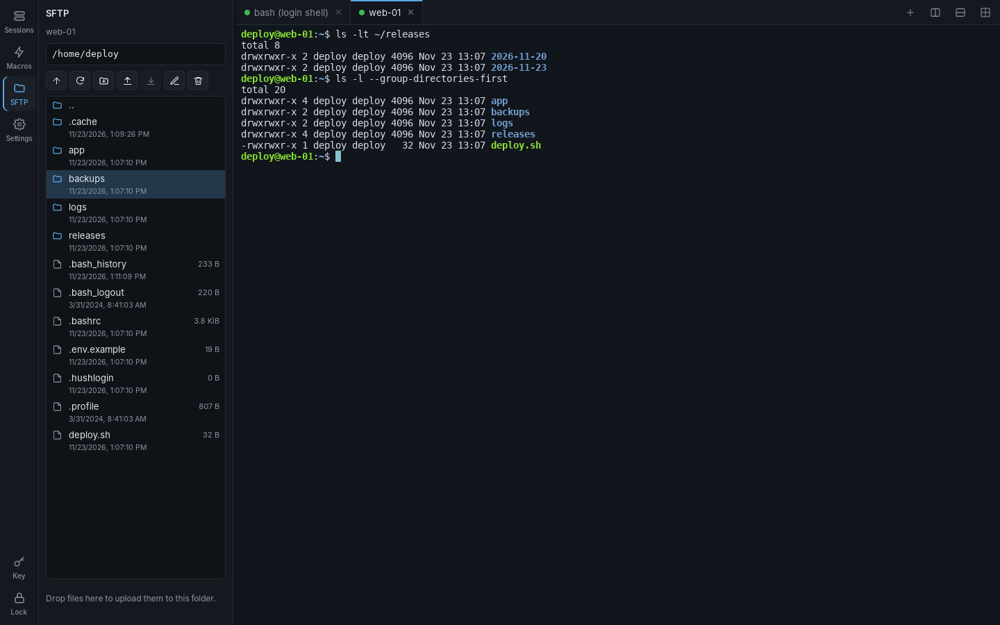

# Siakap Terminal

Siakap Terminal is an internal terminal and SSH client for Windows 10 and 11. I wanted something that looks as clean as Tabby,
has MobaXterm's habit of putting an SFTP browser next to the terminal, and keeps the macros I've been using in
Siakap. It also had to keep everything encrypted on disk and stay quiet on the network.

It runs on Linux too. macOS will probably work, but I haven't tried it.



<table>
  <tr>
    <td width="50%"></td>
    <td width="50%"></td>
  </tr>
  <tr>
    <td align="center"><sub>Four panes in one tab</sub></td>
    <td align="center"><sub>A macro asking for a value, with a live preview</sub></td>
  </tr>
  <tr>
    <td width="50%"></td>
    <td width="50%"></td>
  </tr>
  <tr>
    <td align="center"><sub>Serial console over a USB cable</sub></td>
    <td align="center"><sub>SFTP over the same connection</sub></td>
  </tr>
</table>

## Features

- **Tabs and split panes.** Local shells (PowerShell 7, Windows PowerShell, cmd, and any WSL distro) and SSH
  sessions, in tabs that split side by side, top and bottom, or straight into a 2×2 grid. You can drag the dividers.
- **Starts where you left off.** Pick what opens when the app starts: nothing, a shell such as your WSL distro, or a
  saved session, in one, two or four panes. You can also choose which shell new tabs use.
- **Encrypted vault.** Sessions, folders, macros, known hosts, settings and saved passwords all live in one file,
  encrypted with Argon2id and XChaCha20-Poly1305. It locks itself after a configurable idle time, or when you click
  Lock.
- **SSH.** Authentication tries the Windows OpenSSH agent first, then Pageant, then a key file (with a passphrase
  prompt) or a password. FIDO security keys work through the agent. Host keys are trusted on first use, and a
  changed key is refused, full stop.
- **Macros (Siakap compatible).** A macro types a list of commands into the terminal you clicked last. Highlight a
  value and click *Make input* to be asked for it on every run (`{{Switch port}}`), with a live preview and a paste
  button. Optionally edit the whole command before a run without changing the saved macro. Organise them in folders
  with drag and drop, duplicate, rename, search across folders (and inside commands), and import or export Siakap
  backups, including the ones made by the Siakap Tabby plugin.
- **Startup commands.** A saved session can type commands once its prompt is ready, optionally in a start folder.
- **Command status on tabs.** The dot on each tab turns blue while a command runs, green on success and red on
  failure.
- **Serial consoles.** Connect to switches, routers and other devices over a COM port, like you would in PuTTY or
  MobaXterm. Ports are detected automatically (plug in a USB console cable and it shows up), the speed is picked
  from a dropdown (9600 by default, up to 921600, or a custom rate), and data bits, parity, stop bits and flow
  control can be changed. `Ctrl+Shift+B` sends a break for password recovery.
- **SFTP.** The side panel follows whichever SSH tab is focused and reuses its connection. Browse, create folders,
  rename, delete, download and upload with the native file dialogs, or drag files onto the panel. Transfers stream in
  chunks, show progress and can be cancelled.
- **Security keys in WSL.** One button hands a USB security key over to WSL with `usbipd`, and gives it back to
  Windows when you click it again.
- **No phoning home.** There is no telemetry, no update check and no analytics, and the app loads no remote fonts or
  scripts. The only network connections it makes are the SSH sessions you open.

## Installing

Grab the installer from the [Releases](https://github.com/Shaqqiem/siakap-term/releases) page (you need access to
this repository): either the `setup.exe` (installs per user, no admin needed) or the `.msi`. Each release comes with
a `SHA256SUMS.txt`. Check the file you downloaded before running it:

```powershell
Get-FileHash -Algorithm SHA256 '.\Siakap Terminal_0.1.0_x64-setup.exe'
```

You need Windows 10 or 11 (x64). The app uses WebView2, which Windows 11 already has; on Windows 10 the installer
adds it if it's missing. If you want agent authentication, turn on the OpenSSH agent service or run Pageant. The
security key button needs [usbipd-win](https://github.com/dorssel/usbipd-win) 4.x.

The first time it starts, Siakap asks you to choose a master password and creates the vault at
`%APPDATA%\dev.siakap.terminal\vault.json`. There's no recovery if you forget the password.

## Using it

| What | How |
| --- | --- |
| New local shell | `Ctrl+Shift+T`, the + button, or pick one under *Local shells* |
| Split the focused pane | `Ctrl+Shift+D` side by side, `Ctrl+Shift+E` top and bottom |
| Split into four panes | `Ctrl+Shift+G`, or the grid button in the tab bar |
| Open a serial console | **+ Serial**, or click a port under *Serial ports* |
| Send a break (serial) | `Ctrl+Shift+B` |
| Close a pane | `Ctrl+Shift+W`, or press Enter once the session has ended |
| Switch tabs | `Ctrl+Tab` and `Ctrl+Shift+Tab` |
| Copy and paste | `Ctrl+Shift+C` and `Ctrl+Shift+V`; copy on select is in Settings |
| Stop a running macro | `Esc`, or the Stop button in the macro bar |
| Hide the side panel | Click the active icon in the left rail, or double-click the panel edge |

When the clipboard contains more than one line, the app shows what's about to be pasted and asks first. You can turn
this off in Settings, but I'd leave it on.

### Writing macros

```text
# Lines starting with # are notes.
show interface {{Switch port}} status
# @wait 1500
# @type y
```

Each ordinary line is typed and followed by Enter; blank lines are skipped. The `#` before `@wait` and `@type` is
optional, and `@ wait 100` or `@WAIT 100` work too; other lines starting with `@` (such as `@echo off`) are typed as
normal. The editor shows what each line will do as you write it. `# @wait 1500` pauses for 1.5 seconds
(the limit is one hour, and Stop cancels the wait). `# @type y` types `y` without pressing Enter. `{{Switch port}}` is
an input: it's asked for once per run, however many times it appears, and its name can contain spaces. The easiest
way to make one is to highlight the value in the editor, type a name and click **Make input**.

By default, placeholder values may only contain letters, digits, spaces and `_ . / : @ , + -`, which keeps a stray
`;` or `$(...)` out of your commands. You can switch to unrestricted mode in Settings; control characters are still
rejected there, so a value can never sneak in an extra Enter.

A macro only types into the pane that had focus when you started it. If that pane closes or you click into another
one, the macro stops.

### Moving from the Siakap Tabby plugin

In the Siakap plugin, export a backup (*Export sessions and macros*). In Siakap Terminal, open **Macros** and click
the import button, then pick that file. Macros, folders and SSH, local and serial sessions come across, along with their
startup commands. Two things are deliberate:

- Imported macros ask you to review them before their first run.
- Imported startup commands are switched off until you turn them on in each session.

Passwords are never part of a backup.

### Guided tour

The first time you start Siakap Terminal, a short tour points out each part of the app. After an update, it only
shows what's new since the version you last used. Replay it any time from **Settings > Show the tour again**.

### Startup

Under Settings > Startup you can choose what opens when Siakap starts:

- **When Siakap starts:** nothing, a local shell, or one of your saved sessions.
- **Layout:** one pane, two side by side, or a 2×2 grid of that shell or session.
- **Default shell for new tabs:** for example `WSL: Ubuntu`, so `Ctrl+Shift+T` opens WSL instead of PowerShell.

The startup action runs once, the first time you unlock the vault after starting the app.

### Security keys and WSL

usbipd has to share the key once, and that needs an elevated terminal. Siakap won't try to elevate for you:

```powershell
usbipd list
usbipd bind --busid <BUSID>
```

After that, the key button in the left rail attaches every plugged-in security key to WSL, or detaches them all. If some
are attached and some aren't, it refuses and asks you to fix that by hand.

## Building from source

On Windows you need [Rust](https://rustup.rs) (stable, MSVC toolchain), the "Desktop development with C++" workload
from the Visual Studio Build Tools, and [Node.js](https://nodejs.org) 22 or newer.

```powershell
npm ci
npm run tauri dev
```

`npm run tauri build` produces the installers in `target\release\bundle\nsis` and `target\release\bundle\msi`.

On Linux you'll also need the WebKitGTK and udev development packages:
`libwebkit2gtk-4.1-dev librsvg2-dev libayatana-appindicator3-dev libudev-dev`.

### Tests

```powershell
cargo test -p siakap-core
npm test
npm run build
```

The Rust tests cover the vault, the macro parser, folder handling, usbipd output parsing and host-key checks. `npm test`
runs the TypeScript macro parser tests with Node's built-in runner. `npm run build` type-checks the frontend and
builds it.

There's also a live SSH and SFTP test. It only runs when you point it at a real server whose home directory contains a
file called `big.bin`:

```powershell
$env:SIAKAP_TEST_SSH = "user:password@127.0.0.1:22"
cargo test -p siakap-core --test ssh_live
```

CI runs the tests on `windows-latest` and builds both installers on every push (see
[`.github/workflows/build.yml`](.github/workflows/build.yml)). The first time a new version number reaches `main`,
CI also publishes a release for it with the installers and `SHA256SUMS.txt`. To ship an update, bump `version` in
`src-tauri/tauri.conf.json` and `package.json`, then push to `main`.

## Project layout

```text
core/              Rust library with no Tauri dependency
  vault.rs           encrypted storage
  model.rs           sessions, macros, settings, folder rules
  macros.rs          macro parser and input validation
  pty.rs             local shells (ConPTY on Windows)
  ssh.rs             SSH client and host-key checks
  sftp.rs            SFTP over an existing SSH connection
  serial.rs          serial ports and consoles
  security_key.rs    usbipd integration
src-tauri/         Tauri commands, app state and capabilities
src/               TypeScript frontend built on xterm.js
docs/screenshots/  images used in this README
```

## Known limitations

- SFTP can only delete empty folders.
- If an agent offers OpenSSH certificates, those are skipped; plain keys work.
- Locking the vault hides your terminals but doesn't disconnect them. SECURITY.md explains why.
- Keyboard-interactive login (servers that prompt for a one-time code) isn't supported yet.

## Security

See [SECURITY.md](SECURITY.md) for what the app protects against, what it doesn't, and how to report a problem.

## License

Proprietary. For internal use only; not for redistribution.
